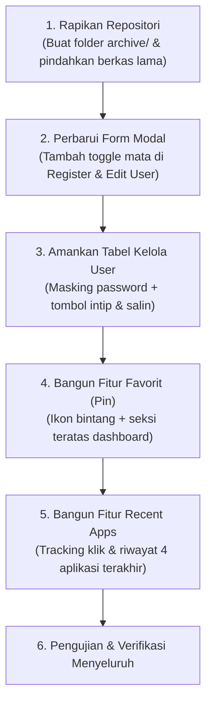

# CATATAN RENCANA PERUBAHAN & PENGEMBANGAN
## PORTAL LAYANAN BIDANG SMP - DINAS PENDIDIKAN & KEBUDAYAAN KABUPATEN KARANGANYAR

*Dokumen ini merupakan integrasi menyeluruh dari hasil review aplikasi, analisis kode, dan kesepakatan sesi wawancara desain (`/grill-me`) bersama Mas Bos.*

---

## 1. Ringkasan Eksekutif & Identitas Aplikasi

* **Nama Aplikasi**: Portal Layanan Bidang SMP
* **Sub-Domain/Target**: Hub/Launcher terpadu seluruh sistem informasi dan aplikasi Google Apps Script / Web App di lingkungan Bidang SMP Disdikbud Karanganyar.
* **Branding**: *"Digitally Shaped by JeMPROT [BID SMP 2026]"*
* **Platform**: Progressive Web App (PWA) & Standalone Android APK (via Capacitor & GitHub Actions).
* **Basis Data Aktif**: **Supabase** (PostgreSQL + Realtime WebSocket) pada URL `https://tmtzbzkdtwigiwfizahi.supabase.co`.

---

## 2. Hasil Review & Analisis Awal (Temuan Teknis)

Dari penelaahan seluruh berkas (`index.html`, `index_lama.html`, `kode.gs`, `sw.js`, `manifest.json`, dan workflow CI/CD), diperoleh temuan berikut:

### A. Kelebihan yang Sudah Berjalan
1. **Antarmuka Modern**: Menggunakan Slate Dark Mode dengan Tailwind CSS dan FontAwesome, responsif di ponsel dan desktop.
2. **Iframe Viewer Terintegrasi**: Membuka aplikasi internal tanpa keluar portal, dilengkapi anti-cache URL (`_refresh=timestamp`) dan tombol salin akun GAS.
3. **Sensor Realtime Aktif**: Mendeteksi perubahan data aplikasi dan user secara otomatis via Supabase Realtime channel.
4. **Alur Build APK Otomatis**: Workflow GitHub Actions siap merakit APK Android debug menggunakan Capacitor.

### B. Area yang Memerlukan Perbaikan
1. **Visibilitas Password**: Password pengguna tersaji dalam bentuk teks terbuka (*plain text*) di tabel SuperAdmin.
2. **Form UX**: Hanya form login yang memiliki tombol mata (intip password), sedangkan form pendaftaran dan form edit belum ada.
3. **Ketiadaan Fitur Akses Cepat**: Pengguna harus selalu mencari atau scroll aplikasi rutin karena belum ada fitur bookmark/favorit dan riwayat akses terakhir.
4. **Kerapian Repositori**: Terdapat berkas cadangan lama `index_lama.html` dan skrip Google Apps Script `kode.gs` di root repositori yang berpotensi membingungkan.

---

## 3. Hasil Sesi Wawancara Desain (`/grill-me`)

Seluruh cabang keputusan teknis telah didiskusikan dan diputuskan bersama Mas Bos:

| No | Topik Keputusan | Pilihan yang Disepakati | Alasan & Dampak |
| :---: | :--- | :--- | :--- |
| **1** | **Basis Data Utama** | **Tetap pakai Supabase secara penuh** | Supabase sudah aktif berjalan dan memiliki fitur real-time. File `kode.gs` (Google Sheets) dialihkan ke arsip. |
| **2** | **Keamanan Password User di Admin** | **Masking (`••••••••`) + Tombol Mata & Salin** | Menjaga privasi visual layar admin dari orang di sekitarnya, namun tetap memberi kemudahan admin untuk mengecek/menyalin password saat operator sekolah lupa sandi. |
| **3** | **Fitur Peningkatan Dashboard** | **1. Aplikasi Favorit (Pin/Bintang)** **2. Riwayat Terakhir Dibuka (Recent Apps)** | Mempercepat akses kerja harian operator sekolah ke 2-3 aplikasi utama tanpa perlu mencari atau scroll. |
| **4** | **Bilah Iframe Viewer** | **Dipertahankan sederhana seperti sekarang** | Tetap bersih, fokus, dan tidak membebani tampilan dengan tombol-tombol yang jarang dipakai. |
| **5** | **Form UX Password** | **Tambah ikon mata di modal Register & Edit** | Mencegah salah ketik password saat pendaftaran baru maupun saat admin mengedit akun. |
| **6** | **Manajemen Berkas Lama** | **Pindahkan ke folder `archive/`** | Memindahkan `kode.gs` dan `index_lama.html` ke `archive/` agar riwayat tetap aman tetapi root proyek bersih. |

---

## 4. Rencana Aksi Eksekusi Terinci (Action Plan)

### Rincian Perubahan per Komponen:

#### A. Penataan Berkas (File Organization)
* Buat direktori: `archive/`
* Pindahkan `kode.gs` $\rightarrow$ `archive/kode.gs`
* Pindahkan `index_lama.html` $\rightarrow$ `archive/index_lama.html`

#### B. Formulir Pendaftaran & Edit User (`index.html`)
* **Modal Register (`#modal-register`)**:
  - Kolom `#reg-pass` ditambahkan tombol pembungkus relatif dengan tombol `<button type="button" onclick="togglePasswordVisibility('reg-pass', 'eye-icon-reg')">` dan `<i id="eye-icon-reg" class="fa-solid fa-eye"></i>`.
* **Modal Edit User (`#modal-edit-user`)**:
  - Kolom `#edit-user-password` ditambahkan tombol pembungkus relatif serupa dengan id `eye-icon-edit-user`.

#### C. Tabel Kelola User SuperAdmin (`index.html`)
* Pada fungsi `renderUsersTable()`:
  - Kolom password tidak lagi merender `${user.password}` telanjang.
  - Dirender dengan masking default `••••••••`, elemen teks tersembunyi, tombol toggle mata untuk melihat, dan tombol salin ke clipboard dengan notifikasi toast.

#### D. Fitur Aplikasi Favorit (Pin/Bookmark)
* **Penyimpanan**: `localStorage.getItem('smp_fav_' + currentUser.username)`
* **Ikon Kartu**: Menambahkan tombol bintang di setiap kartu aplikasi.
* **Tampilan**: Jika ada aplikasi yang ditandai favorit, render blok baru di bagian paling atas grid aplikasi berjudul **"⭐ Aplikasi Favorit"**.

#### E. Fitur Riwayat Terakhir Dibuka (Recent Apps)
* **Penyimpanan**: `localStorage.getItem('smp_recent_' + currentUser.username)` (maksimal 4 item).
* **Perekaman**: Saat fungsi `openAppViewer(appId)` dieksekusi, ID aplikasi otomatis dimasukkan ke urutan terdepan daftar riwayat.
* **Tampilan**: Render barisan chip/kartu mini kompak **"🕒 Terakhir Dibuka"** tepat di bawah bilah pencarian / atas seksi favorit.

---

## 5. Rencana Verifikasi & Pengujian (QA Checklist)

- [x] **Kerapian Root**: Pastikan hanya berkas aktif di root (`index.html`, `manifest.json`, `sw.js`, aset ikon, dan `.github`).
- [x] **Uji Form Register**: Pastikan ikon mata dapat menampilkan dan menyembunyikan karakter password saat mengetik akun baru.
- [x] **Uji Form Edit User**: Pastikan ikon mata pada modal edit user berfungsi normal.
- [x] **Uji Tabel Admin**:
  - Buka Kelola User sebagai SuperAdmin.
  - Pastikan password bertopeng `••••••••`.
  - Klik ikon mata: teks password terbuka.
  - Klik ikon salin: toast konfirmasi muncul dan teks password tersalin ke clipboard.
- [x] **Uji Fitur Favorit**:
  - Klik ikon bintang pada kartu aplikasi (misal: "Laporan SPMB").
  - Pastikan aplikasi tersebut langsung muncul di blok "Aplikasi Favorit".
  - Refresh browser: status bintang dan posisi favorit tetap bertahan.
- [x] **Uji Riwayat Terakhir**:
  - Buka aplikasi via viewer, lalu kembali.
  - Pastikan aplikasi tersebut tercatat di baris "Terakhir Dibuka".
- [x] **Uji Top Bar Auto-Hide & Floating Pill**:
  - Buka aplikasi via viewer: top bar overlay muncul 3,5 detik (menutupi banner GAS saat tampil), lalu otomatis menyusut menjadi floating pill di atas tengah.
  - Klik tombol Pin (`fa-thumbtack`) untuk mengunci top bar agar tidak auto-hide bila diperlukan.
- [ ] **Uji Build & Git Status**: Pastikan `git status` bersih dan perubahan tercatat dengan rapi.
